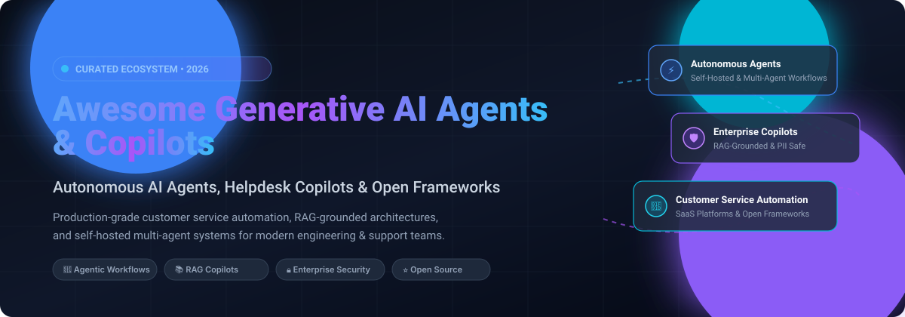
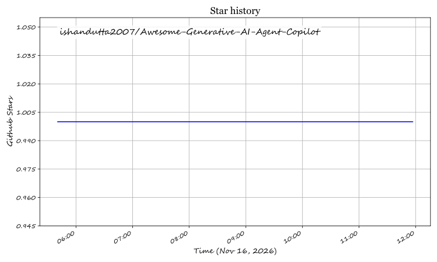

  

# 🤖 Awesome-Generative-AI-Agent-Copilot

  
  
  
  
  
  

## 🌟 Top Generative AI Agent & Copilot Ecosystem

**Curated List of SaaS Platforms & Open-Source GitHub Projects**  
*Focused on Agentic Customer Service, RAG-Grounded Copilots & Self-Hosted Multi-Agent Frameworks*  
**Last updated: March 2026**

Welcome to the definitive, SEO-optimized repository and landscape guide for **Generative AI Agents, Helpdesk AI Copilots, and Autonomous LLM Frameworks**. As enterprise AI evolves beyond single-prompt chatbots into multi-turn agentic workflows, organizations require reliable solutions for automated ticket resolution, RAG knowledge retrieval, real-time agent assist, and secure enterprise automation.

This curated list benchmarks enterprise **SaaS platforms** against production-grade **open-source AI agent frameworks**, detailing transparent pricing tiers, free trial allowances, company market valuations, and GitHub Stars_Counts.

---

## 📑 Table of Contents
- [📊 Sector Overview & Market Dynamics](#-sector-overview--market-dynamics)
- [💼 SaaS & Hosted Copilot Platforms](#-saas--hosted-copilot-platforms)
- [🔓 Open-Source GitHub Projects & Agent Frameworks](#-open-source-github-projects--agent-frameworks)
- [🛠️ Architecture & Deployment Trade-Offs](#-architecture--deployment-trade-offs)
- [🤝 How to Contribute](#-how-to-contribute)
- [☕ Support & Sponsorship](#-support--sponsorship)
- [📈 Star History](#-star-history)
- [⚠️ Disclaimer](#-disclaimer)

---

## 📊 Sector Overview & Market Dynamics

The global market for **Generative AI in customer service and agentic copilots** is currently estimated at **$12B–$13B in 2025/2026** and projected to surge past **$50B–$80B by the early 2030s**, compounding at an annual growth rate (CAGR) exceeding 25%. 

The sector exhibits **moderate-to-high application-layer fragmentation**: specialized AI-native agent startups (such as Ada, Forethought, and Sierra) compete vigorously against established CRM and helpdesk incumbents (Salesforce Agentforce, Zendesk Copilot, Freshworks Freddy AI). Simultaneously, the developer tooling and foundational compute/LLM layer remains highly concentrated among hyperscalers and frontier model providers.

---

## 💼 SaaS & Hosted Copilot Platforms

Enterprise customer support and service-desk copilots providing turnkey integrations, CRM grounding, and managed conversational AI.

| Product | Description | Company Size (Valuation / Revenue) | Pricing (Starting Tier) | Free Tier / Trial Limits |
|---------|-------------|-----------------------------------|-------------------------|--------------------------|
| **[Salesforce Einstein Copilot / Agentforce](https://www.salesforce.com/)** | Autonomous agent platform and copilot grounded in CRM data via Einstein Trust Layer for customer service and sales workflows. | **~$180B–$250B market cap** (~$38B–$41B FY revenue) | **$2.00 per conversation** (usage-based) or **$5/user/month** (metered Agentforce user add-on) / **$125/user/month** (unmetered Service Cloud add-on) | **30-day free trial** (pre-configured Service Cloud / Agentforce environment without credit card); also provides continuous free **Agentforce Developer Edition** (active login every 45 days) |
| **[Zendesk Copilot](https://www.zendesk.com/)** | AI assistant within Zendesk that suggests responses, auto-summarizes tickets, and surfaces internal knowledge. | **$10.2B acquisition valuation** (surpassed $2B ARR) | **$50/agent/month** (billed annually as Advanced AI Copilot add-on, requires Suite Professional at $115/agent/month) | **14-day free trial** (Suite Professional environment with full AI tools evaluation; extendable by 14 days upon request; 6-month trial for qualifying startups) |
| **[Freshworks AI Copilot](https://www.freshworks.com/)** | Freddy AI assistant embedded across Freshdesk and Freshservice for ticket drafting, summarization, and triage. | **~$3.5B market cap** (~$838M FY2025 revenue) | **$29/agent/month** (billed annually; $35/agent/month billed monthly, add-on for Pro & Enterprise plans) | **14-day free trial** (Pro/Enterprise tier trial with full access to Freddy AI features; no credit card required) |
| **[Intercom Fin](https://www.intercom.com/)** | Autonomous customer service AI agent resolving conversations and human-agent copilot for ticket assistance. | **$3.6B acquisition valuation** (~$400M ARR; Fin alone at ~$100M ARR) | **$0.99 per resolved outcome** (plus Essential base workspace starting at **$29/seat/month** billed annually) | **14-day free trial** (unlimited Fin AI agent resolution testing during trial period with zero outcome charges; no credit card required) |
| **[Ada](https://www.ada.cx/)** | Omnichannel enterprise customer service automation platform with no-code agent building across chat, voice, and email. | **$430M acquisition valuation** (peak $1.2B Series C; ~$50M–$70M ARR) | **~$30,000–$35,000/year** starting enterprise contract (~$1.00–$3.50 per resolved interaction over baseline) | No self-serve free trial (guided enterprise sandbox / Proof of Concept available via sales demo for qualifying high-volume teams) |
| **[Forethought](https://forethought.ai/)** | Support automation suite (Solve, Triage, Assist) utilizing generative AI for ticket routing and autonomous resolution. | **~$115M total venture funding** (acquired by Zendesk in 2026; estimated $20M–$40M ARR) | **~$40,000/year** platform commitment (with usage fees of ~$0.07–$0.12+ per deflected interaction) | No self-serve free trial (structured Proof of Value [POV] sandbox utilizing historical ticket data provided upon sales demo) |

---

## 🔓 Open-Source GitHub Projects & Agent Frameworks

Self-hosted AI agents, open-source copilot platforms, and community-driven customer service automation stacks for complete data sovereignty, zero vendor lock-in, and custom orchestration. Sorted in descending order of GitHub community stars.

| Project | Stars_Badge | Description |
|---------|------------|-------------|
| **[Dify](https://github.com/langgenius/dify)** |  | **Leading open-source LLM application development platform and agent orchestrator.** Features a visual workflow builder combining multi-agent coordination, knowledge retrieval (RAG), tool calling, and human-in-the-loop validation. Ideal for self-hosted or private cloud customer service bots. |
| **[OpenHands](https://github.com/All-Hands-AI/OpenHands)** |  | **Autonomous AI development and task execution agent platform** (formerly OpenDevin). Capable of reading code, executing bash commands, browsing the web, and resolving complex technical tickets end-to-end. |
| **[Open Interpreter](https://github.com/KillianLucas/open-interpreter)** |  | **Natural-language interface for computers and local code execution.** Runs local or remote LLMs (Ollama, Claude, GPT-4) to control terminal commands, analyze support datasets, and automate desktop workflows. |
| **[AutoGen](https://github.com/microsoft/autogen)** |  | **Microsoft's multi-agent conversational orchestration framework.** Enables next-generation LLM applications via multiple cooperating, autonomous agents that converse to solve complex customer routing and resolution pipelines. |
| **[CrewAI](https://github.com/crewAIInc/crewAI)** |  | **Framework for orchestrating role-playing autonomous AI agents.** Assign specific roles, backstories, and goals to agents (e.g., Support Researcher, Ticket Responder, Quality Auditor) to automate collaborative customer support. |
| **[Flowise](https://github.com/FlowiseAI/Flowise)** |  | **Beginner-friendly drag-and-drop visual builder for AI agents and LLM flows.** Features Assistant, Chatflow, and Agentflow modules with 100+ native connectors, vector store integrations, and embeddable customer service chat widgets. |
| **[LibreChat](https://github.com/danny-avila/LibreChat)** |  | **Enterprise-grade self-hosted multi-provider AI chat and agent platform.** Features native Model Context Protocol (MCP) support, OpenAI/Anthropic/Google/Bedrock multi-model access, SSO (SAML, OAuth, LDAP), moderation tools, and agent marketplaces. |
| **[Chatwoot](https://github.com/chatwoot/chatwoot)** |  | **Self-hosted omnichannel customer engagement platform and helpdesk.** Open-source alternative to Intercom and Zendesk featuring live chat, email, WhatsApp, and extensible AI agent integration hooks. |
| **[Khoj](https://github.com/khoj-ai/khoj)** |  | **Self-hostable AI second brain and personal assistant.** Connects with internal documents (PDFs, markdown, Notion) and web search to run custom agents, schedule background automations, and provide grounded answers. |
| **[GPT Researcher](https://github.com/assafelovic/gpt-researcher)** |  | **Autonomous research agent that surfaces factual insights across documentation and web sources.** Produces detailed, citation-backed investigative reports to power support triage and knowledge-base synthesis. |
| **[Rasa](https://github.com/RasaHQ/rasa)** |  | **Established conversational AI framework with enterprise NLU and dialogue engine.** Gives engineering teams full deterministic control over business logic, custom actions, and localized data governance. |
| **[E2B](https://github.com/e2b-dev/E2B)** |  | **Secure sandboxed execution environment for AI agents.** Lets autonomous agents run code, terminal commands, and browser actions in isolated microVMs without endangering host infrastructure. |
| **[Upsonic](https://github.com/Upsonic/Upsonic)** |  | **Production-oriented AI agent framework with built-in Safety Engine.** Engineered with pre-configured policies for PII blocking, real-time audit logging, prompt defense, OCR parsing, MCP integration, and human-in-the-loop workflows. |
| **[Multi-Agent Support System](https://github.com/ali7832/multi-agent-customer-support-system)** |  | **Reference architecture for multi-agent support ticket routing.** Implements FastAPI endpoints, Docker orchestration, SLA assignment rules, and a React operations dashboard (Routing Lab & Agent Cockpit). |
| **[Znuny-LLM](https://github.com/znuny)** |  | **Security-first LLM integration for Znuny ITSM and service desks.** Runs entirely on private infrastructure via Ollama or OpenAI endpoints with automated ticket classification, multilingual summaries, and built-in prompt-injection defenses. |

---

## 🛠️ Architecture & Deployment Trade-Offs

When designing or procuring an AI copilot and agent architecture, support and platform engineering leaders generally balance three key dimensions:

1. **Turnkey Commercial Copilots (Intercom Fin, Zendesk Copilot, Salesforce Agentforce)**:
   - *Pros*: Immediate time-to-value, seamless UI integration with existing support queues, managed safety guards, and built-in reporting.
   - *Trade-offs*: Outcome or seat-based licensing fees that scale with ticket volume; proprietary guardrail configurations; cloud data residency constraints.

2. **Self-Hosted AI Chat & Agent Platforms (LibreChat, Chatwoot, Khoj)**:
   - *Pros*: Full data sovereignty, zero per-seat licensing, compatibility with self-hosted LLMs (e.g., Llama 3 via Ollama or vLLM), and flexible authentication (SSO/SAML).
   - *Trade-offs*: Infrastructure provisioning, maintenance, and custom glue code required for ticketing and CRM bi-directional sync.

3. **Autonomous Agent & Orchestration Frameworks (Dify, AutoGen, CrewAI, Flowise, Upsonic)**:
   - *Pros*: Multi-agent delegation (specialized billing, technical, and triage personas), dynamic tool calling via Model Context Protocol (MCP), and enterprise security engines.
   - *Trade-offs*: Requires software engineering for custom prompt chains, tool definition, memory tuning, and regression testing.

---

## 🤝 How to Contribute

Contributions from the open-source community and AI engineers are warmly welcomed!

1. 🍴 Fork the repository.
2. 🌿 Create a descriptive feature branch (`git checkout -b feature/add-new-agent-tool`).
3. 📝 Update `README.md` following the standard table formatting, including accurate pricing/stars and factual descriptions.
4. 🚀 Open a Pull Request with a clear explanation of why the tool is valuable to the Generative AI Copilot ecosystem.

---

## ☕ Support & Sponsorship

If you find this curated ecosystem list helpful for your research, company architecture, or open-source projects, please consider supporting the project!

- ⭐ **Star this repository** to help others discover it!
- 🍴 **Fork and share** with fellow developers and support leaders.
- 💖 **Sponsor on GitHub**: Support ongoing curation and open-source research via the [GitHub Sponsors Dashboard](https://github.com/sponsors/ishandutta2007).

---

## 📈 Star History

---

## ⚠️ Disclaimer

- This is an independent, **community-curated** list for educational, architectural, and informational purposes. Mention does not constitute an endorsement.
- Generative AI copilots interact directly with customer inquiries and handle sensitive personal data. Teams must enforce robust **prompt-injection defenses**, strict **PII anonymization**, and human-in-the-loop review boundaries for financial or account-altering actions.

---

  <b>Built with ❤️ for support leaders, AI architects, and developers engineering autonomous customer systems.</b>

## ⭐ Star History

<a href="https://star-history.com/#ishandutta2007/Awesome-Generative-AI-Agent-Copilot&Timeline" align="center">
  <picture>
    <source media="(prefers-color-scheme: dark)" srcset="assets/ishandutta2007_Awesome-Generative-AI-Agent-Copilot_growth.svg">
    
  </picture>
</a>
